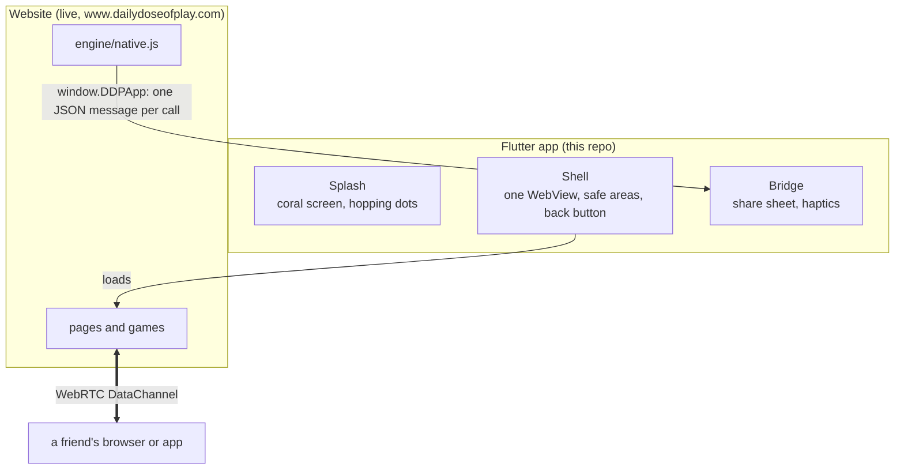

# Architecture

The app is a thin native shell around the website. It shows
https://www.dailydoseofplay.com in one full-screen WebView and adds only what
a browser tab can't do: a launch splash, the phone's share sheet, haptics and
the Android back button. Every game, rule, lobby and screen stays JavaScript
in the website's repository,
[Faezehyas/dailydoseofplay](https://github.com/Faezehyas/dailydoseofplay)
(read its `ARCHITECTURE.md`, section **Mobile app**). The app never
re-implements a game.

## Files

| File | What it does |
|---|---|
| `lib/main.dart` | The app: a `MaterialApp` whose only screen is the shell |
| `lib/shell.dart` | The WebView, which links stay inside, safe areas, the page's background, the back button, and the splash over it all until the first page loads |
| `lib/splash.dart` | The Flutter half of the splash: timing, the hop, the words and Try again |
| `lib/bridge.dart` | The app's side of `engine/native.js`: parses each message and calls the share sheet or the haptic engine |
| `ios/Runner/Base.lproj/LaunchScreen.storyboard`, `ios/Runner/Assets.xcassets/` | The native launch screen and the app icon |
| `android/app/src/main/res/` | The Android launch screen, adaptive icon and colours |

Platform code (Swift, Kotlin) stays as `flutter create` made it; anything
native goes through a plugin.

## Splash

"The screen is the logo", as picked on the loading review (`ddp-landing`,
`public/loading/`): the whole screen is the website's `--accent` (`#ff6b4a`,
`#ff7a5c` in dark mode) and the logo's four dots are `--accent-ink`
(`#1a0e0a`), top right and bottom left at 55%, 36 pt each with a 26 pt gap.

1. The native launch screen (iOS storyboard, Android `launch_background` and
   the Android 12+ splash attributes) is that picture standing still, so the
   first frame needs no Flutter.
2. Flutter draws the same dots in the same place. From 300 ms they hop in
   turn (the site's `@keyframes hop`, 1.6 s each, 0.2 s apart). The words
   "Opening the games" come in at 2 s; at 10 s "Taking a while? Check your
   connection or try again." and a Try again button, which loads the site
   again and restarts the 10 s.
3. When the WebView's first page finishes without an error, the splash fades
   out over 450 ms with a slight zoom and leaves the tree. A page that fails
   (offline) keeps the splash up.

With the system's reduce-motion setting the dots stay still, only the words
change, and the splash goes without the fade. The icons and launch images are
drawn from the same geometry as the site's `favicon.svg` and
`icons/maskable-512.png`.

## Shell

- **One WebView** (`webview_flutter`, the Flutter team's plugin) with
  JavaScript on. It opens `https://www.dailydoseofplay.com/`.
- **Links.** Main-frame navigations to `www.dailydoseofplay.com` or
  `dailydoseofplay.com` over https stay in the WebView; any other address
  (another site, `mailto:`) opens in the system browser or app through
  `url_launcher`, and the WebView stays where it was.
- **Safe areas.** The WebView sits inside a `SafeArea`; the strips around it
  (status bar, home indicator, notch) take the page's background colour. Each
  page reports `getComputedStyle(document.body).backgroundColor` on the
  `DDPBackground` channel when it loads and again whenever `<html
  data-theme>` (the site's theme setting) or the system's light or dark
  setting changes. Status bar icons are dark on the coral splash and on a
  light page, light on a dark page.
- **Light and dark.** The site follows `prefers-color-scheme`, which the
  WebView takes from the system; the splash picks its coral the same way.
- **Back button (Android).** Back goes back in the WebView while it can, then
  leaves the app.

## Bridge

`engine/native.js` on the site reads `window.DDPApp` as it loads. The shell
adds that channel before any page script runs (webview_flutter injects it at
document start, in every frame), and the page posts one JSON string per call:

| Message | The app |
|---|---|
| `{ type: "share", text, url }` | Opens the share sheet with `text url` (`share_plus`) |
| `{ type: "haptic", kind }` | `light`, `medium` or `heavy` impact (Flutter's `HapticFeedback`); anything else is light |

Unknown types and malformed messages are ignored, so a newer site never
breaks an older app. Without the channel (any browser) the site behaves as on
the web.

## WebRTC

Friend games connect the app's WebView to the other player over a WebRTC
DataChannel, exactly as two browsers do. WKWebView (iOS 14.3+) and Android
System WebView both support `RTCPeerConnection` and data channels; the site
never asks for the camera or microphone, so no permission prompts or
`Info.plist` usage strings are involved. Checked on the iOS 26 simulator:
a Tic Tac Toe friend game against a desktop browser connected and finished with
no extra iOS settings. Still to check: a physical iPhone on a different
network, and Android.

## Not here yet

- **Offline (M3).** The plan: bundle the site's `public/` folder and serve it
  from a local `http://localhost` origin when the network is down, so robot
  games and tutorials work offline. `webview_flutter` can load that origin
  from a small `dart:io` server, so no other WebView package is needed.
- **App links.** The site serves `/.well-known/apple-app-site-association` and
  `assetlinks.json` once its `APPLE_TEAM_ID` and `ANDROID_CERT_SHA256` secrets
  are set; the app's associated domains and intent filters come with signing.

## Tests

- `test/` (widget tests, no device): the splash timing, the hop and reduce
  motion, the fade, a failed load, which links stay inside, the back button,
  the frame colour, and the bridge's parsing. `test/fake_webview.dart` is a
  fake WebView platform that records what the shell asks and plays the page's
  side.
- `integration_test/` (a simulator, emulator or phone, and the network): the
  real WebView loads the live site, and the site's own `engine/native.js`
  reaches the app's bridge.
